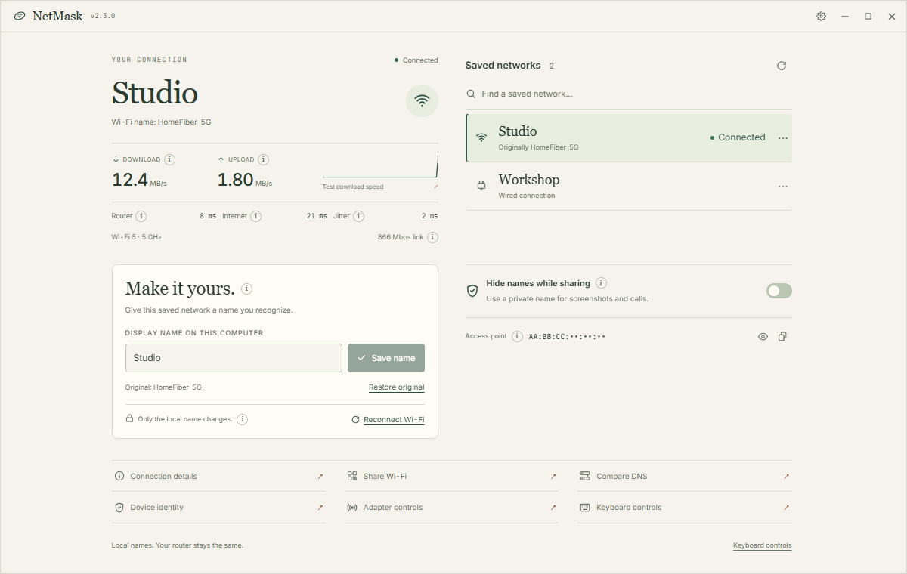

<p align="center"><picture><source media="(prefers-color-scheme: dark)" srcset="src/renderer/public/branding/mark-light.svg"></picture></p>

<h1 align="center">NetMask</h1>
<p align="center"><strong>Your networks. Your names.</strong></p>
<p align="center">Give a saved network a name you recognise, see how your connection is doing,<br>and use a private local display name. A small desktop app for Windows, macOS, and Linux.</p>

<p align="center"><picture><source media="(prefers-color-scheme: dark)" srcset="docs/assets/fieldnotes-dark.png"></picture></p>

<p align="center"><sub>Fieldnotes in Paper and Dark. Screenshots show fictional networks and sample measurements.</sub></p>

## Make it yours

- **Use a familiar name.** Turn `HomeFiber_5G` into `Studio` on your computer. The original is saved so you can restore it.
- **Read your connection.** See transfer activity, response time, and the Wi-Fi details your system provides. Small information buttons explain the numbers.
- **Mask the active display name.** Use a private local label, manually or while a supported broadcast app runs.
- **Keep useful tools close.** Reconnect saved Wi-Fi, compare DNS lookup times, run a small download test, or share a supported Wi-Fi network with a QR code.

Only local labels change; your router keeps its Wi-Fi name. Display privacy masks selected fields; check other screens and apps before sharing. It does not make your connection anonymous.

## Get NetMask

**Latest: v2.3.2** · [Release notes](https://github.com/billighost/netmask/releases/tag/v2.3.2)

| Windows 10 / 11 | macOS 12+ | Linux |
| --- | --- | --- |
| **x64**<br>[EXE / MSI downloads](https://github.com/billighost/netmask/releases/tag/v2.3.2) | [Apple silicon / Intel downloads](https://github.com/billighost/netmask/releases/tag/v2.3.2) | **x64 · NetworkManager**<br>[DEB / AppImage downloads](https://github.com/billighost/netmask/releases/tag/v2.3.2) |

Run the Windows installer, drag the Mac app into Applications, or install the Linux package. For AppImage, make the file executable first.

[Checksums](https://github.com/billighost/netmask/releases/download/v2.3.2/checksums.txt) · [Installation and privacy notes](SECURITY.md) · [All releases](https://github.com/billighost/netmask/releases)

The release page lists available installers. A platform awaiting a build runner is added after a successful retry.

## A little room goes a long way

Paper and Dark themes, custom controls, and explanations where you need them. Shrink the window to **320 × 200** and scroll through the app and its dialogs.

<details>
<summary>Platform details</summary>

Windows edits Network List labels, macOS edits network service labels, and Linux edits NetworkManager connection names. Available tools depend on your OS and adapter; unsupported controls explain their limits. Some Wi-Fi details and saved credentials require system permission. QR codes contain readable Wi-Fi credentials.

</details>

## Measured Tauri memory

On the recorded Windows 11 production build, median private resident memory across NetMask and its isolated WebView2 descendants was **135.8 MiB visible** and **119.6 MiB hidden in the tray**. These are 15-sample medians after 30- and 60-second settling periods, without explicit memory trimming. Hardware, ranges, other memory metrics, method, limitations, and the raw samples are in [Performance measurement](BENCHMARKS.md).

## Build it

Built with **Tauri 2, Rust, React, and TypeScript**. Install Node.js 22.12+, Rust 1.90+, and the [Tauri prerequisites](https://v2.tauri.app/start/prerequisites/), then:

```sh
npm ci
npm run dev
```

[Contributing](CONTRIBUTING.md) · [Architecture](docs/ARCHITECTURE.md) · [Audit](docs/AUDIT.md) · [Product and launch plan](docs/PRODUCT_STRATEGY.md) · [Release guide](RELEASE_GUIDE.md)

Created and maintained by **Bello Bilal** · [@billighost](https://github.com/billighost) · `bb2010ng@gmail.com` · [MIT](LICENSE)
