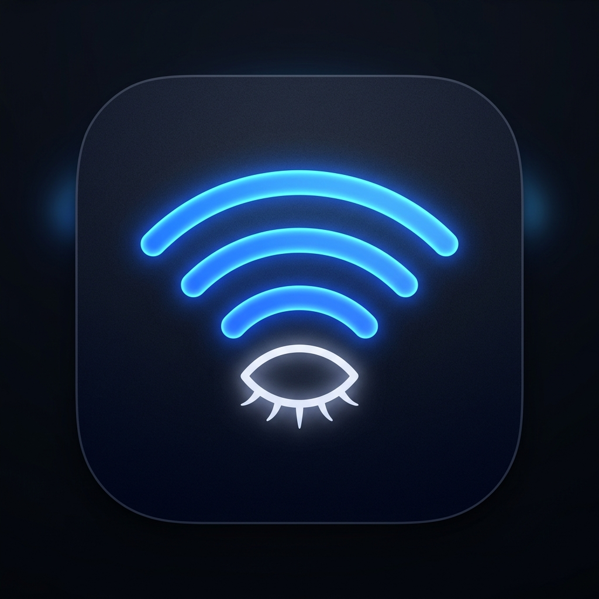
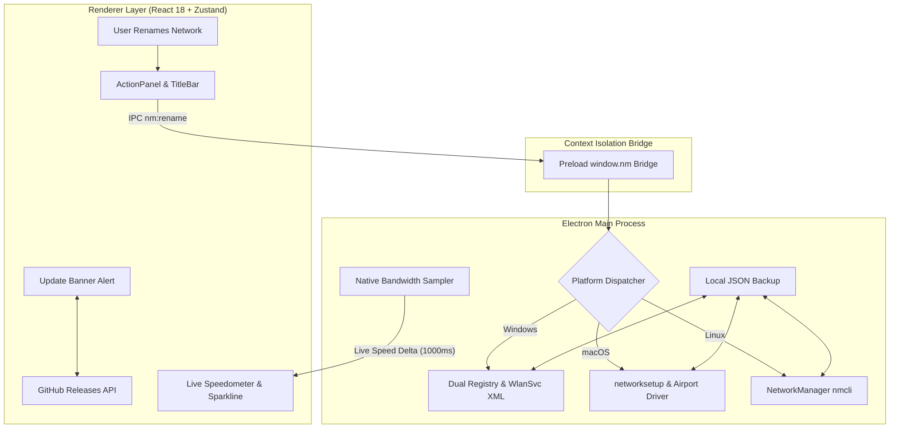

<div align="center">



# 🎭 NetMask 2.0

### *Cloak your networks. Master your bandwidth. Present with total confidence.*

A cross-platform desktop application to rename and disguise local Wi-Fi and Ethernet display names across your system, paired with sub-second throughput diagnostics and streaming intelligence.

[](https://github.com/billighost/netmask/releases/latest)
[](https://github.com/billighost/netmask/releases)
[](https://github.com/billighost/netmask/actions/workflows/ci.yml)
[](https://github.com/billighost/netmask/actions/workflows/release.yml)
[](LICENSE)
[](#-cross-platform-matrix)

<br/>

### ⚡ Quick Download (Latest: v2.0.0)

| Platform | Recommended Installer | Alternative Formats |
| :--- | :--- | :--- |
| **Windows 11 / 10** | [📥 **Download Setup (.exe)**](https://github.com/billighost/netmask/releases/latest/download/NetMask-Setup-2.0.0.exe) | [Portable (.exe)](https://github.com/billighost/netmask/releases/latest/download/NetMask-Windows-2.0.0-x64.exe) • [Zip (.zip)](https://github.com/billighost/netmask/releases/latest/download/NetMask-Windows-2.0.0-x64.zip) |
| **macOS (Apple Silicon)** | [📥 **Download DMG (arm64)**](https://github.com/billighost/netmask/releases/latest/download/NetMask-macOS-2.0.0-arm64.dmg) | [Zip Archive](https://github.com/billighost/netmask/releases/latest/download/NetMask-macOS-2.0.0-arm64.zip) |
| **macOS (Intel x64)** | [📥 **Download DMG (x64)**](https://github.com/billighost/netmask/releases/latest/download/NetMask-macOS-2.0.0-x64.dmg) | [Zip Archive](https://github.com/billighost/netmask/releases/latest/download/NetMask-macOS-2.0.0-x64.zip) |
| **Linux (All Distros)** | [📥 **Download AppImage**](https://github.com/billighost/netmask/releases/latest/download/NetMask-Linux-2.0.0-x86_64.AppImage) | [Tarball (.tar.gz)](https://github.com/billighost/netmask/releases/latest/download/NetMask-Linux-2.0.0-x64.tar.gz) |
| **Linux (Ubuntu / Debian)** | [📥 **Download Debian (.deb)**](https://github.com/billighost/netmask/releases/latest/download/NetMask-Linux-2.0.0-amd64.deb) | `sudo dpkg -i NetMask*.deb` |

<br/>

[**All Releases & Changelog**](https://github.com/billighost/netmask/releases) • [**Report Bug**](https://github.com/billighost/netmask/issues/new?template=bug_report.yml) • [**Request Feature**](https://github.com/billighost/netmask/issues/new?template=feature_request.yml) • [**Contributing**](CONTRIBUTING.md)

</div>

---

## 📖 The Story: Why NetMask Exists

Picture this: You are sharing your screen during a high-stakes client presentation, livestreaming on Twitch, or recording an instructional video for hundreds of viewers. You click on your Wi-Fi settings in the taskbar or menu bar to verify your connection.

Suddenly, everyone in the meeting sees:
> `FBI-Surveillance-Van-3B` &nbsp;|&nbsp; `Apartment-4G-Personal-Private` &nbsp;|&nbsp; `Mom-And-Dad-5GHz`

Your physical location, personal life, or humorous network names are broadcast to the world.

### Enter NetMask.
**NetMask solves this cleanly and reversibly.** It changes how your operating system displays your network name locally without touching your router's hardware SSID, without interrupting your roommates, and without altering your router configuration. Rename `Apartment-4G-Personal-Private` to `Ultra-Fiber-Pro` in one second. Restore it back with one click whenever you want.

---

## ⚡ Highlights at a Glance

| Feature | What It Does | Why You Care |
| :--- | :--- | :--- |
| 🎭 **Local Disguise Engine** | Renames local Wi-Fi profiles across OS UI, Settings, and Taskbar | Zero router changes; total screen-sharing privacy |
| ⚡ **Sub-Second Throughput** | Real-time byte-level I/O speed sampling in MB/s & KB/s | Instant visibility into download & upload activity |
| 📊 **Real-Time Sparkline** | 60-second animated bandwidth history curve | Identify stutter, spikes, and connection drops immediately |
| 🎬 **Streaming Advisor** | Plain-English translation of speeds into 4K, 1080p, or 720p capability | Know at a glance whether you can stream 4K 60FPS |
| 🔄 **One-Click Reconnect** | Instantly cycles the radio adapter to apply names | No need to reboot or toggle hardware switches |
| 🛡️ **Zero-Risk Rollback** | Preserves original hardware SSIDs in an encrypted JSON snapshot | Restore individual networks or all networks in 1 click |
| 🚀 **In-App Auto-Updater** | Discrete top banner alerts you when a new release is published | Stay up to date without manually checking GitHub |

---

## 🌐 Cross-Platform Matrix

NetMask features native platform abstraction drivers for every major operating system:

| Platform | Network Name Sync Subsystems | Live Bandwidth Sampling | Elevation Method |
| :--- | :--- | :--- | :--- |
| **Windows 11 / 10** | Dual Registry (`HKLM\...\NetworkList`) + `netsh wlan` XML profile sync | Native `netstat -e` byte differential | UAC prompt via PowerShell `RunAs` |
| **macOS (Sonoma / Ventura / Monterey)** | `networksetup` preferred wireless profiles + AirPort framework | `netstat -ib` interface byte delta | AppleScript `with administrator privileges` |
| **Linux (Ubuntu / Fedora / Arch)** | NetworkManager (`nmcli connection modify`) | `/proc/net/dev` kernel byte counters | Polkit (`pkexec`) |

---

## 🏗️ Architecture: How It Works Under The Hood



<details>
<summary><b>🔍 Deep Dive: Dual-Sync on Windows</b></summary>

Windows separates connection identity across two isolated layers:
1. **The Network List Service (`HKLM\SOFTWARE\Microsoft\Windows NT\CurrentVersion\NetworkList\Profiles`)**: Controls what Windows Settings (*"Manage known networks"*), Network and Sharing Center, and network adapters display.
2. **The WLAN AutoConfig Service (`netsh wlan` / XML Profiles in `%ProgramData%\Microsoft\Wlansvc\Profiles\Interfaces`)**: Controls what appears in the **Taskbar Quick Settings Wi-Fi flyout** and the System Tray.

NetMask exports the active XML profile, patches both the `<name>` element and registry profile keys atomically, re-imports the profile, and triggers an adapter refresh. The hardware SSID broadcast by your router and your WPA2/WPA3 password remain 100% untouched.
</details>

<details>
<summary><b>🍎 Deep Dive: macOS Integration</b></summary>

macOS maintains network profiles through `/Library/Preferences/SystemConfiguration/preferences.plist` and `networksetup`. NetMask interfaces with `networksetup -listpreferredwirelessnetworks` and updates local profile aliases while preserving Wi-Fi Keychain credentials.
</details>

<details>
<summary><b>🐧 Deep Dive: Linux Integration</b></summary>

On Linux, NetMask communicates with the system D-Bus and `nmcli` (NetworkManager) to update `connection.id` descriptors without modifying `802-11-wireless.ssid` credentials, while monitoring network bytes through `/proc/net/dev`.
</details>

---

## 📦 Installation & Download

### Windows
Download the latest installer or portable executable from [GitHub Releases](https://github.com/billighost/netmask/releases/latest):
- **Setup Installer (`.exe`)**: `NetMask-Setup-2.0.0.exe` (Recommended)
- **Standalone Portable (`.exe`)**: `NetMask-Windows-2.0.0-x64.exe` (No installation needed)
- **Archive (`.zip`)**: `NetMask-Windows-2.0.0-x64.zip`

> [!NOTE]
> If Windows SmartScreen shows *"Windows protected your PC"* when launching an unsigned community release, click **More info** &rarr; **Run anyway**. See [Security & Code Signing](#-security-code-signing--smartscreen) below for why this happens and our verification steps.

### macOS
- **Apple Silicon / Intel Disk Image**: `NetMask-macOS-2.0.0-arm64.dmg` / `x64.dmg`
- Drag and drop `NetMask.app` into your `/Applications` folder.

### Linux
- **AppImage**: `NetMask-Linux-2.0.0-x86_64.AppImage` (Make executable: `chmod +x *.AppImage` and run)
- **Debian / Ubuntu Package**: `NetMask-Linux-2.0.0-amd64.deb` (`sudo dpkg -i NetMask*.deb`)
- **Tarball**: `NetMask-Linux-2.0.0-x64.tar.gz`

---

## 🎮 Keyboard Shortcuts & Power Tips

| Shortcut | Action |
| :--- | :--- |
| <kbd>Ctrl</kbd> + <kbd>R</kbd> &nbsp;/&nbsp; <kbd>F5</kbd> | Force refresh all network interfaces and connection status |
| <kbd>Esc</kbd> | Dismiss open context menus or modal dialogs |
| <kbd>Right Click</kbd> on Network Row | Open quick context menu: Rename, Reconnect, Restore, Details |
| **Double Click** on Network Row | Jump immediately into rename editor |

---

## 🛡️ Security, Code Signing & Checksums

### Verification & SHA-256 Checksums (v2.0.0)

| File | SHA-256 Checksum |
| :--- | :--- |
| `NetMask-Setup-2.0.0.exe` | `97B17E94350912FB911CE27951FF9C43B256B9E8B7DFD9A73BF1489AFE5D8B6C` |
| `NetMask-Windows-2.0.0-x64.exe` | `9C675ADBAD50782CED477C57FAB7BD047E12A77EE95A0DA4D06602F9005FD4C7` |
| `NetMask-Windows-2.0.0-x64.zip` | `EB46D35AEAC3CF9EF8F2459653AE3E55B0474D96AE3B6C73C78AEFA7CBBC2E1A` |

Verify checksum in PowerShell:
```powershell
Get-FileHash .\NetMask-Setup-2.0.0.exe -Algorithm SHA256
```

<details>
<summary><b>Why does Windows SmartScreen display "Unknown Publisher"? (Click to expand)</b></summary>

When running open-source software on Windows, Microsoft Defender SmartScreen displays a warning for newly released binaries:
1. **Download Reputation**: SmartScreen relies on aggregate user download volume. New versions have a trust score of 0 until several hundred users have installed them.
2. **EV Hardware Certificates**: Microsoft requires Extended Validation (EV) certificates stored on physical USB cryptographic tokens costing \$300–\$600 per year, which is impractical for non-commercial open-source contributors.

We are currently onboarding NetMask to **[SignPath.io](https://about.signpath.io/)**, a trusted non-profit code signing service for open-source projects, to provide automated signing in future releases.
</details>

---

## 💻 Developer Setup & Contributing

We welcome community pull requests! To set up NetMask locally:

```bash
# 1. Clone the repository
git clone https://github.com/billighost/netmask.git
cd netmask

# 2. Install dependencies
npm install

# 3. Start development server with hot-reload
npm run dev

# 4. Run TypeScript checks
npm run typecheck

# 5. Build multi-platform production artifacts
npm run dist:win      # Windows installer & portable
npm run dist:mac      # macOS DMG & zip
npm run dist:linux    # Linux AppImage & deb
```

Read our [Contributing Guide](CONTRIBUTING.md) and [Code of Conduct](CODE_OF_CONDUCT.md) for details on branching, issue filing, and PR rules.

---

## 📜 License

Distributed under the **MIT License**. See [`LICENSE`](LICENSE) for more information.

---

<div align="center">

Crafted with care for privacy advocates, streamers, and developers worldwide.  
**If you find NetMask useful, please consider giving it a ⭐ on GitHub!**

</div>
