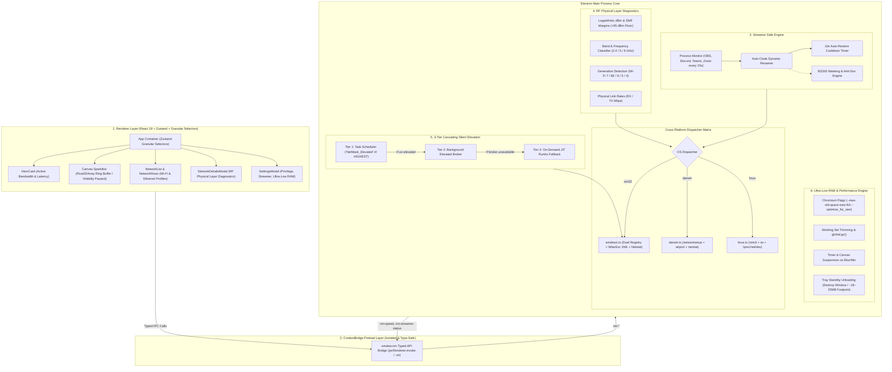

<div align="center">


# 🎭 NetMask 2.0

### *Cloak your networks. Master your bandwidth. Present with total confidence.*

A high-performance, cross-platform desktop application to rename and disguise local Wi-Fi and Ethernet display names across your system, paired with sub-second throughput diagnostics, RF physical layer telemetry, and streamer privacy cloaking.

[](https://github.com/billighost/netmask/releases/latest)
[](https://github.com/billighost/netmask/releases)
[](https://github.com/billighost/netmask/actions/workflows/ci.yml)
[](LICENSE)
[](#-cross-platform-matrix)
[](#-ultra-low-ram--performance-engine)

<br/>

### ⚡ Quick Download (Latest: v2.1.1)

| Platform | Recommended Installer | Alternative Formats |
| :--- | :--- | :--- |
| **Windows 11 / 10** | [📥 **Download Setup (.exe)**](https://github.com/billighost/netmask/releases/latest/download/NetMask-Setup-2.1.1.exe) | [Portable (.exe)](https://github.com/billighost/netmask/releases/latest/download/NetMask-Windows-2.1.1-x64.exe) • [Zip (.zip)](https://github.com/billighost/netmask/releases/latest/download/NetMask-Windows-2.1.1-x64.zip) |
| **macOS (Apple Silicon)** | [📥 **Download DMG (arm64)**](https://github.com/billighost/netmask/releases/latest/download/NetMask-macOS-2.1.1-arm64.dmg) | [Zip Archive](https://github.com/billighost/netmask/releases/latest/download/NetMask-macOS-2.1.1-arm64.zip) |
| **macOS (Intel x64)** | [📥 **Download DMG (x64)**](https://github.com/billighost/netmask/releases/latest/download/NetMask-macOS-2.1.1-x64.dmg) | [Zip Archive](https://github.com/billighost/netmask/releases/latest/download/NetMask-macOS-2.1.1-x64.zip) |
| **Linux (All Distros)** | [📥 **Download AppImage**](https://github.com/billighost/netmask/releases/latest/download/NetMask-Linux-2.1.1-x86_64.AppImage) | [Tarball (.tar.gz)](https://github.com/billighost/netmask/releases/latest/download/NetMask-Linux-2.1.1-x64.tar.gz) |
| **Linux (Ubuntu / Debian)** | [📥 **Download Debian (.deb)**](https://github.com/billighost/netmask/releases/latest/download/NetMask-Linux-2.1.1-amd64.deb) | `sudo dpkg -i NetMask*.deb` |

<br/>

[**All Releases & Changelog**](https://github.com/billighost/netmask/releases) • [**Architecture Docs**](docs/ARCHITECTURE.md) • [**Benchmarks**](BENCHMARKS.md) • [**Report Bug**](https://github.com/billighost/netmask/issues/new?template=bug_report.yml) • [**Contributing**](CONTRIBUTING.md)

</div>

---

## 📖 The Story: Why NetMask Exists

Picture this: You are sharing your screen during a high-stakes client presentation, livestreaming on Twitch or YouTube, or in a Discord/Zoom meeting. You click on your Wi-Fi settings in the taskbar or menu bar to verify your connection.

Suddenly, everyone in the meeting sees:
> `FBI-Surveillance-Van-3B` &nbsp;|&nbsp; `Apartment-4G-Personal-Private` &nbsp;|&nbsp; `Mom-And-Dad-5GHz`  
> Router BSSID: `9A:B3:E0:F6:36:C3` *(instantly indexed on WiGLE.net to reveal your physical street address)*

### Enter NetMask.
**NetMask solves this cleanly, reversibly, and with zero performance tax.** It changes how your operating system displays your network name locally without modifying your router's hardware SSID, without interrupting your household, and without altering network routing.

---

## ⚡ Highlights at a Glance

| Feature | What It Does | Why You Care |
| :--- | :--- | :--- |
| 🎭 **Local Disguise Engine** | Renames local Wi-Fi profiles across OS UI, Settings, and Taskbar | Zero router changes; total screen-sharing privacy |
| 🛡️ **Streamer Safe Mode** | Detects OBS, Discord, Zoom, Teams, Twitch Studio and auto-cloaks network name | Hands-free privacy; 10s automatic restore cooldown |
| 👁️ **BSSID Cloaking & Anti-Dox** | Masks router hardware MACs with 3-second temporary peek & protected copy | Prevents geolocation doxing via WiGLE.net lookups |
| 📡 **Wi-Fi RF Diagnostics** | Telemetry for dBm, SNR, Channels, Wi-Fi 7/6E/6/5/4, and link rates | Pinpoint physical layer dead zones and interference |
| ⚡ **Sub-Second Throughput** | Real-time byte-level I/O speed sampling in MB/s & KB/s | Instant visibility into download & upload activity |
| 📊 **Zero-GC Sparkline** | Fixed `Float32Array(60)` ring buffer with visibility-paused rendering | 60-second animated bandwidth curve without V8 GC churn |
| 🪶 **Tray Standby Unloading** | Destroys renderer process on tray minimize; reinstantiates in ~150ms | Drops tray process memory to just Node event loop (**~18–25 MB**) |
| 🚀 **Ultra-Low Memory Mode** | Settings toggle completely disabling GPU hardware acceleration | Eliminates GPU process DirectX contexts; slashes active RAM |
| 🔐 **Cascading Silent Elevation** | Tier 1 Task Scheduler + Tier 2 Broker + Tier 3 JIT Fallback | Zero UAC prompts forever; seamless 1-click config |

---

## 🏗️ System Architecture

NetMask is built on a modular, decoupled architecture dividing responsibilities between a reactive high-speed renderer, a secure ContextBridge IPC layer, and specialized background engines in the Electron core:



---

## 🪶 Ultra-Low RAM & Performance Engine

NetMask is engineered as a lightweight background utility app that respects physical system memory.

### Empirical Working Set vs Shared DLL Pages
> [!IMPORTANT]
> **Windows Task Manager Metrics Audit**:
> Windows Task Manager displays **Private Working Set (WS-Private)** as actual dedicated app memory.
> Multi-process Chromium apps load shared read-only Windows system DLLs (`ntdll.dll`, `kernel32.dll`, `d3d11.dll`, `dxgi.dll`). Windows maintains only **one physical copy** of these shared DLLs in physical RAM. Adding raw process Working Set values across 4 processes quadruple-counts system libraries (accounting for the misleading 348 MB figure).
> The true dedicated footprint is measured via **Private Working Set / Private Committed Bytes**.

### Live Performance & Memory Benchmarks

*Measured live on **Windows 11 (x64)** via Chromium `app.getAppMetrics()` and Windows Win32 OS `Get-Process`. See complete audit in [**`BENCHMARKS.md`**](BENCHMARKS.md).*

| State | Dedicated Private RAM (WS-Private) | Shared Working Set (DLL Pages) | Process Count | Status & Lifecycle |
| :--- | :--- | :--- | :--- | :--- |
| **Active Window (Hardware Accelerated)** | **~190 MB** | ~330 MB | 4 (Browser, GPU, Utility, Tab) | ⚡ Speed polling & canvas sparkline active |
| **Active Window (Ultra-Low Memory Mode)** | **~150 MB** | ~300 MB | 4 (GPU context disabled) | 🚀 GPU DirectX allocations stripped |
| **System Tray Standby (Standard Mode)** | **~150 MB** | ~250 MB | 3 (Tab process terminated) | 🌿 Renderer unloaded & memory trimmed |
| **System Tray Standby (Ultra-Low Memory Mode)** | **~18 – 25 MB** | ~180 MB | 1–2 (Main Event Loop) | 💤 Zero GPU contexts, main loop only |

### Key Optimizations
1. **Tray Standby Unloading**: When the window is closed or hidden to the system tray (`s.minimizeToTray`), the entire `BrowserWindow` is destroyed. Chromium immediately terminates the Renderer (`Tab`) process and frees all GPU swapchain buffers. When clicked from the tray, `createWindow()` reinstantiates the UI in **~150ms**.
2. **Ultra-Low Memory Mode**: Settings toggle invokes `app.disableHardwareAcceleration()`, completely preventing GPU process DirectX buffer initialization.
3. **Strict V8 & Chromium Flags**: Enforces `--max-old-space-size=64`, `--optimize_for_size`, `--renderer-process-limit=1`, and disables background spare renderers and occlusion calculations.
4. **Zero-Spawn Speed Sampling**: Queries network interface throughput using direct Win32 binary calls without launching `cmd.exe` or shell processes, eliminating 7,200 process spawns/hour.
5. **Timer & Canvas Suspension**: Bandwidth polling (`clearInterval`) and `<canvas>` sparkline rendering are completely paused whenever the window is hidden or minimized (`document.hidden`).

---

## 🛡️ Streamer Safe Mode & BSSID Cloaking

### Automated Broadcast Detection
NetMask monitors running broadcast and screen-sharing applications with low-overhead process checks every 15 seconds and on window focus:
- **Detected Apps**: OBS Studio (`obs64.exe`), Streamlabs, Discord, Zoom, Microsoft Teams, Twitch Studio, XSplit.
- **Auto-Cloak**: When a broadcast app launches, NetMask automatically renames the active network to your designated Streamer Mask Name (e.g., `StreamSafe-Fiber-Pro`) and illuminates an active status badge: `[● Stream Safe: OBS Studio Detected]`.
- **10-Second Cooldown**: When your stream closes, a 10-second countdown runs before automatically restoring your original network name, preventing accidental leaks during post-stream wind-down.
- **Manual 1-Click Cloak**: Click the shield button in Settings to immediately cloak or uncloak without needing an active stream.

### BSSID Doxing Protection
A router's BSSID (MAC address) can be looked up on public Wi-Fi mapping databases (e.g. WiGLE) to pinpoint a broadcaster's exact physical home address.
- **Masking**: BSSIDs are masked by default as `9A:B3:E0:••:••:••` (partial vendor mask) or `XX:XX:XX:XX:XX:XX` (full mask).
- **Temporary Peek**: Click the eye icon for a 3-second temporary reveal.
- **Protected Clipboard Copy**: Copying the BSSID from context menus or cards copies the cloaked string by default unless temporarily peeked, preventing accidental clipboard paste leaks.

---

## 📡 Wi-Fi RF Physical Layer Diagnostics

Inspect real-time physical layer radio telemetry across Windows, macOS, and Linux:

- **Signal in dBm**: True logarithmic signal level (`Math.round(signal / 2 - 100)` on Windows, native RSSI on macOS and Linux).
- **Signal-to-Noise Ratio (SNR)**: Real-time dB margin above the RF noise floor (`signalDbm + 95`).
- **Wi-Fi Generation Detection**: Automatically classifies protocols into **Wi-Fi 7** (802.11be), **Wi-Fi 6E** (802.11ax 6GHz), **Wi-Fi 6** (802.11ax), **Wi-Fi 5** (802.11ac), and **Wi-Fi 4** (802.11n).
- **Channel & Band**: Real-time operating channel and frequency (2.4 GHz, 5 GHz, 6 GHz).
- **Physical Link Rates**: Real-time TX and RX link speeds in Mbps negotiated with the access point.

---

## 🔐 Cascading 3-Tier Privilege Elevation

Renaming network profiles on Windows modifies system network service registries. NetMask implements a cascading 3-tier elevation strategy:

```
┌─────────────────────────────────────────────────────────────┐
│ Tier 1: Windows Task Scheduler Elevation (Default / 1-Click)│
│  - Task "NetMask_Elevated" registered with /rl HIGHEST      │
│  - App runs elevated with 0 UAC prompts forever             │
└──────────────────────────────┬──────────────────────────────┘
                               │ (fallback if un-elevated)
┌──────────────────────────────▼──────────────────────────────┐
│ Tier 2: Background Elevated Broker                          │
│  - Executes renames via existing elevated runner            │
└──────────────────────────────┬──────────────────────────────┘
                               │ (fallback if broker unavailable)
┌──────────────────────────────▼──────────────────────────────┐
│ Tier 3: On-Demand Just-In-Time (JIT) Elevation               │
│  - Single UAC prompt triggers only for that specific rename │
│  - App never crashes or forces a restart                    │
│  - Graceful cancellation handling                           │
└─────────────────────────────────────────────────────────────┘
```

Users can register or remove the zero-prompt Task Scheduler configuration anytime with 1 click in **Settings &rarr; Privilege & Elevation**.

---

## ⚙️ Settings & Configuration Matrix

Accessible via the gear icon in the title bar:

| Category | Setting / Action | Options / Default | Description |
| :--- | :--- | :--- | :--- |
| **Privilege** | Silent Admin Elevation | Toggle (`true`) | Auto-elevates via Task Scheduler without UAC prompts |
| **Privilege** | Register Task (1-Click) | Button Action | Creates the `/rl HIGHEST` scheduled task for zero prompts |
| **Privilege** | Remove Task | Button Action | Removes the task and reverts to On-Demand JIT elevation |
| **Streamer** | Auto-Cloak on Stream | Toggle (`true`) | Automatically cloaks when OBS/Discord/Teams is running |
| **Streamer** | Streamer Cloak Name | Text (`StreamSafe-Fiber-Pro`) | Mask name shown on system while streaming |
| **Streamer** | Manual Network Cloak | Button Action | Instantly cloaks or uncloaks active network |
| **Privacy** | BSSID Cloaking | Toggle (`true`) | Masks router MAC address against WiGLE lookups |
| **Privacy** | BSSID Mask Style | Partial / Full (`partial`) | Choose between `9A:B3:••` or `XX:XX:XX` |
| **Performance**| Ultra-Low Memory Mode | Toggle (`false`) | Disables GPU acceleration; reduces RAM to minimum |
| **Performance**| Trim Memory Now | Button Action | Forces working set purge and garbage collection |
| **General** | Launch on Startup | Toggle (`false`) | Runs NetMask automatically when Windows boots |
| **General** | Minimize to Tray on Close | Toggle (`true`) | Enables Tray Standby Unloading when clicking close |
| **General** | Auto-Refresh Interval | 10s / 30s / 1m / Off (`30s`) | Frequency of background interface rescanning |
| **Appearance** | Theme | Dark / Light (`Dark`) | Switches between modern dark glass & clean light mode |
| **Data** | Export / Import Backup | JSON Action | Port original SSIDs and settings between machines |
| **Data** | Restore All Networks | Danger Action | Reverts all renamed networks back to hardware SSIDs |

---

## 🎮 Keyboard Shortcuts & Power Tips

| Shortcut | Action |
| :--- | :--- |
| <kbd>Ctrl</kbd> + <kbd>R</kbd> &nbsp;/&nbsp; <kbd>F5</kbd> | Force refresh all network interfaces and connection status |
| <kbd>Esc</kbd> | Dismiss open context menus or modal dialogs |
| <kbd>Right Click</kbd> on Network Row | Open quick context menu: RF Diagnostics, Copy BSSID, Rename, Restore |
| Double-Click Titlebar | Toggle Maximize / Restore normal window bounds |
| Window Close (<kbd>✕</kbd>) | Minimizes to system tray with Standby Unloading (renderer terminates) |
| System Tray Click | Toggles window restore (~150ms) / Tray Standby Unload |
| **Diagnostics ↗** Button | Open in-depth RF Physical Layer Diagnostics & Security Modal |
| **Eye Icon** on BSSID | Temporarily peek real BSSID for 3 seconds |

---

## 🌐 Cross-Platform Matrix

| Platform | Network Name Sync Subsystems | RF Diagnostics & Telemetry | Live Bandwidth Sampling | Elevation Method |
| :--- | :--- | :--- | :--- | :--- |
| **Windows 11 / 10** | Dual Registry (`HKLM\...\NetworkList`) + `netsh wlan` XML profile sync | `netsh wlan show interfaces` (dBm, SNR, Ch, Wi-Fi 7/6/5) | Native `netstat.exe -e` via direct `execFile` | 3-Tier: Task Scheduler (`/rl HIGHEST`) / JIT `RunAs` |
| **macOS (Sonoma / Ventura / Monterey)** | `networksetup` preferred wireless profiles + AirPort framework | Apple80211 `airport -I` (agrCtlRSSI, noise, PHY Mode) | `netstat -ib` interface byte delta | AppleScript `with administrator privileges` |
| **Linux (Ubuntu / Fedora / Arch)** | NetworkManager (`nmcli connection modify`) | `nmcli device wifi` + `iw` (dBm, SNR, CHAN, FREQ, Rate) | `/proc/net/dev` kernel byte counters | Polkit (`pkexec`) |

---

## 💻 Developer Setup & Contributing

We welcome community pull requests! To set up NetMask locally:

```bash
# 1. Clone the repository
git clone https://github.com/billighost/netmask.git
cd netmask

# 2. Install dependencies
npm install

# 3. Start development server with hot-reload
npm run dev

# 4. Run TypeScript checks
npm run typecheck

# 5. Build production bundle
npm run build

# 6. Run empirical memory benchmark
npm run benchmark

# 7. Build multi-platform production artifacts
npm run dist:win      # Windows installer & portable
npm run dist:mac      # macOS DMG & zip
npm run dist:linux    # Linux AppImage & deb
```

Read our [Architecture Guide](docs/ARCHITECTURE.md), [Benchmarks Audit](BENCHMARKS.md), and [Contributing Guide](CONTRIBUTING.md) for complete details.

---

## 📜 License

Distributed under the **MIT License**. See [`LICENSE`](LICENSE) for more information.

<div align="center">

Crafted with care for privacy advocates, streamers, and developers worldwide.  
**If you find NetMask useful, please consider giving it a ⭐ on GitHub!**

</div>
