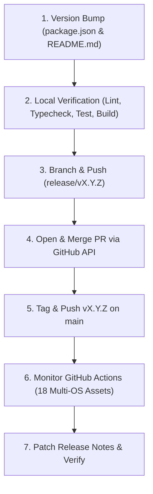

# 🚀 NetMask AI & Developer Release Protocol

> **Target Audience:** AI Coding Assistants (Antigravity, Cursor, Copilot, Claude, etc.) & Maintainers.  
> **Repository:** `billighost/netmask`  
> **Author & Lead Maintainer:** Bello Bilal ([@billighost](https://github.com/billighost) • `bb2010ng@gmail.com`)

---

## 🧭 Overview & Core Principles

NetMask uses a strict CI/CD, branch protection, and verification architecture. When shipping a release, every step must be executed in order. Bypassing tests, breaking React hook rules, or attempting direct pushes to protected branches will break production.

---

## 📋 The 7-Step Release Checklist



---

### Step 1: Version Bumps

Update the semantic version in the following files:

1. **`package.json`**:
   ```json
   "version": "X.Y.Z"
   ```
2. **`README.md`**:
   * Update header: `# 🎭 NetMask vX.Y.Z`
   * Update download table links from previous version to `X.Y.Z`.
   * Update Quick Download header: `### ⚡ Quick Download (Latest: vX.Y.Z)`

> [!NOTE]  
> All UI components (TitleBar, SettingsModal, Tray menu, Captive portal probes) pull the version dynamically at runtime via `app.getVersion()` and `window.nm.getVersion()`. You do **not** need to edit UI components for a version bump.

---

### Step 2: The Mandatory 4-Tier Verification Pipeline

Before creating a release branch, run all 4 validation suites in sequence:

```bash
# 1. React Rules of Hooks AST Static Analyzer (Zero hooks after returns or in conditionals)
npm run lint

# 2. Complete TypeScript Typecheck (0 errors)
npm run typecheck

# 3. Comprehensive 16-point Test Verification Suite
npm test

# 4. Production Bundle Compilation (Main, Preload, and Renderer)
npm run build
```

> [!IMPORTANT]  
> Never commit or push if any of the above commands fail. Fix all errors before proceeding.

---

### Step 3: Branch & Commit (Never Push Directly to `main`)

`main` has **branch protection enabled** on GitHub. Direct pushes (`git push origin main`) are rejected by remote policy.

1. Create a release branch:
   ```bash
   git checkout -b release/vX.Y.Z
   ```
2. Stage and commit:
   ```bash
   git add package.json README.md
   git commit -m "chore(release): vX.Y.Z - <Summary of Changes>"
   ```
3. Push to remote:
   ```bash
   git push -u origin release/vX.Y.Z
   ```

---

### Step 4: Open & Merge Pull Request via Local Git Credentials

To authenticate with GitHub's REST API without exposing tokens or requiring environment secrets, use the machine's Git Credential Manager:

```javascript
// Node.js PR creation and squash-merge pattern:
const { execSync } = require('child_process');
const https = require('https');

// Extract token securely from local credential helper
const out = execSync('git credential fill', { input: 'protocol=https\nhost=github.com\n\n' }).toString();
const token = out.match(/password=(.+)/)[1].trim();

// 1. Create PR
const prBody = JSON.stringify({
  title: 'chore(release): vX.Y.Z - <Release Title>',
  head: 'release/vX.Y.Z',
  base: 'main',
  body: '## Release vX.Y.Z\n<Changelog details>'
});

// POST https://api.github.com/repos/billighost/netmask/pulls
// ...

// 2. Squash merge PR
const mergeBody = JSON.stringify({
  commit_title: 'Merge pull request #<PR_NUM> from billighost/release/vX.Y.Z',
  merge_method: 'squash'
});
// PUT https://api.github.com/repos/billighost/netmask/pulls/<PR_NUM>/merge
```

---

### Step 5: Tag & Push on `main`

Once the pull request has merged:

1. Switch back to `main` and pull the latest squash commit:
   ```bash
   git checkout main
   git pull origin main
   git branch -d release/vX.Y.Z
   ```
2. Create and push the annotated release tag:
   ```bash
   git tag -a vX.Y.Z -m "Release vX.Y.Z - <Release Title>"
   git push origin vX.Y.Z
   ```

---

### Step 6: GitHub Actions Multi-OS Build Pipeline

Pushing tag `vX.Y.Z` automatically triggers `.github/workflows/release.yml`. This workflow runs a matrix build producing **18 multi-platform assets**:

| Runner Platform | Compiled Distributable Assets |
| :--- | :--- |
| **`windows-latest`** | `NetMask-Setup-X.Y.Z.exe`, `NetMask-Windows-X.Y.Z-x64.exe` (portable), `NetMask-Windows-X.Y.Z-x64.zip`, `.blockmap`, `latest.yml` |
| **`macos-latest`** | `NetMask-macOS-X.Y.Z-arm64.dmg`, `NetMask-macOS-X.Y.Z-x64.dmg`, `.zip` archives, `.blockmap`, `latest-mac.yml` |
| **`ubuntu-latest`** | `NetMask-Linux-X.Y.Z-x86_64.AppImage`, `NetMask-Linux-X.Y.Z-amd64.deb`, `NetMask-Linux-X.Y.Z-x64.tar.gz`, `latest-linux.yml` |

#### How to Monitor the Workflow:
Query the GitHub Actions API:
```bash
GET https://api.github.com/repos/billighost/netmask/actions/runs?per_page=3
```
Wait until status is `completed` and conclusion is `success`.

---

### Step 7: Patch Release Notes

Once the GitHub Release object is created by GitHub Actions:
1. Fetch release ID via:
   ```bash
   GET https://api.github.com/repos/billighost/netmask/releases/tags/vX.Y.Z
   ```
2. Send a `PATCH` request to `https://api.github.com/repos/billighost/netmask/releases/<RELEASE_ID>` with detailed Markdown notes, feature highlights, and direct platform download links.

---

## 🧠 Critical Architectural Facts & Lessons Learned

### 1. React Rules of Hooks
* **The Invariant:** In React components, hooks (`useState`, `useEffect`, `useStore`, `useCallback`) **must be declared unconditionally at the very top of the component body**.
* **The Bug:** Placing an early return (e.g. `if (!guid) return null;`) above subsequent `useStore(...)` calls violates React's fiber linked-list indexing. When condition state toggles from false to true, React encounters *more hooks than during the previous render* and unmounts the entire app into a blank screen.
* **The Enforcement:** [`scripts/lint-hooks.js`](file:///c:/Users/bb201/desktop/netmask/scripts/lint-hooks.js) parses the TypeScript AST of every `.tsx` file. Always run `npm run lint` before releasing.

### 2. Standby Unloading vs In-App Update Downloads
* **The Invariant:** When minimizing to the tray, NetMask unloads the Chromium renderer process to drop RAM to ~18–25 MB.
* **The Rule:** If an update is actively downloading (`isUpdateDownloading()`), `destroyWindowToTray()` **must not** destroy the window; it must only hide it (`mainWindow.hide()`). Destroying the window during download wipes the renderer's download progress state and causes reconnect errors upon restore.
* **Updater State Sync:** `window.nm.getUpdateStatus()` syncs active download percent, ready-to-install status, and downloaded installer file path to any newly mounted window.

### 3. Windows Line Endings (`.gitattributes`)
* Text files must use LF line endings on commit (`* text=auto eol=lf` in `.gitattributes`).
* Without this, Windows CRLF conversions create false-positive unstaged changes in Git (`git diff` shows 0 code lines changed, but git status shows modified).

### 4. Silent Elevation Engine
* Windows network profile renaming and adapter DNS configuration require administrator privileges.
* NetMask avoids annoying UAC prompts via a 3-tier elevation cascade:
  1. **Tier 1:** Highest-privilege Task Scheduler task `NetMask_Elevated` (`schtasks.exe /run /tn NetMask_Elevated`).
  2. **Tier 2:** NetMask Elevation Broker service fallback.
  3. **Tier 3:** JIT PowerShell `Start-Process -Verb RunAs` elevation prompt fallback.

### 5. Author Attribution
* Maintainer & Lead Creator: **Bello Bilal**
* Email: `bb2010ng@gmail.com`
* GitHub: [`https://github.com/billighost`](https://github.com/billighost)
* Attribution in `package.json`, `electron-builder.yml`, `SettingsModal.tsx`, and `LICENSE` must always be preserved.
