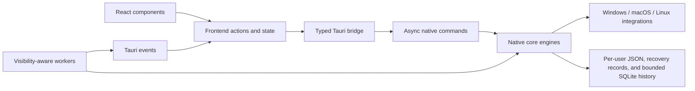

# NetMask architecture

The app has one runtime: Tauri 2 hosts a system webview and a Rust backend. React, TypeScript, Zustand, and Vite build the interface. Network, storage, background, and update operations are native Rust engines.

## Desktop host and native core

`src-tauri/src/lib.rs` owns the main window, branded tray, single-instance lock, worker stop flag, window-size persistence, companion runtime, and orderly shutdown. Closing to the tray persists the supported window state, hides the existing window, emits hidden visibility, and leaves the renderer intact. A later tray or activation request shows and focuses that same window, then delivers any pending intent. The creation path remains as a defensive fallback when no main webview exists; it is not the normal close-to-tray path. Native opted-in monitoring does not depend on the window being visible.

On Windows, closing to the tray schedules three bounded working-set trim passes for the NetMask host and descendant WebView2 processes. Each pass rechecks the native hidden-to-tray state, and reopening cancels the remaining passes. macOS and Linux hide the window without this Windows API. Working-set trimming is an operating-system memory-management request, not proof of a fixed memory result.

The older command handlers live in `commands.rs`; journal, usage, digest, prompt, alert, preset, Going live, and evidence handlers live in `companion_commands.rs`. Slow handlers use `tauri::async_runtime::spawn_blocking` so subprocesses, downloads, locks, SQLite work, and diagnostics do not block the window thread.

The workspace's `netmask-core` crate points to `src-tauri/src/core.rs`. It contains the platform adapters, settings, rename/recovery operations, DNS, transfer measurements, ping, portal detection, QR sharing, identity controls, roaming, streamer automation, updater, observation database, monitoring continuity, robust analysis, and evidence construction. Separating it from the webview permits actual native-engine tests without launching a desktop or changing a real network.

## Connection journal and observed usage

`observations.rs` owns `observations.sqlite3`, a schema-versioned WAL database in the per-user data directory. It stores a network catalog, nullable samples, explicit gaps, observed usage totals and counter checkpoints, per-network limits, retained user-run DNS comparison evidence, calm-alert state, and a dismissible alert inbox. A newer unknown schema is preserved and rejected instead of being overwritten.

Stable network, interface, and access-point identifiers are device-local SHA-256 fingerprints keyed by a random `observation-key.json`. Display labels remain readable for the journal. Deleting all monitoring data removes the database, SQLite sidecars, and observation key; it leaves settings, presets, label recovery, and sharing recovery untouched.

`monitor.rs` records a measured, partial, disconnected, or missing sample without synthesizing absent values. Pause opens a persisted gap that can close after restart. History uses 15-second opportunities. Usage advances only when boot identity, network fingerprint, interface fingerprint, monotonic counters, and maximum gap all remain continuous. A restart, counter reset, adapter change, network switch, or long gap records a new baseline and no guessed bytes. Usage is grouped by saved network and monthly cycle, with persistent limits and separate reset/adapter-change counts.

Retention runs at a bounded cadence and applies both age and row caps. The user-facing choices are 7, 30, and 90 days; internal validation and tests also defend wider engine bounds. SQLite WAL is checkpointed after pruning.

## Analysis, alerts, and provider evidence

`analysis.rs` provides percentiles, median/MAD baselines, weekly findings, DNS-suggestion gates, and alert state machines. A weekly conclusion requires at least 100 measured samples, 25% of expected 15-second opportunities, two observed days, and six hours between first and last measured samples. A DNS suggestion can appear only after a user-run comparison stored for that network shows both at least 10 ms and at least 20% improvement.

Access-point alerts require three consecutive observations and a 24-hour cooldown. Behavior alerts require at least 100 baseline samples, three consecutive high samples above the robust threshold, three recovery samples to unlatch, and a six-hour cooldown. Disabled categories neither mutate their state nor emit alerts. The copy describes a confirmed change and does not infer an attack.

`evidence.rs` constructs a measured-only provider dataset. It reports explicit gaps and limitations, redacts network and access-point identifiers by default, and has no credential field. `companion_commands.rs` limits the selected period to the same 24-hour, 7-day, or 30-day journal range, computes latency and jitter thresholds from the selected network's retained samples, and derives events with an identifier-safe `redactedDetail`. `evidence-report.ts` renders the returned dataset as standalone Fieldnotes HTML or Markdown and previews the exact artifact before download. Sharing mode prevents including network identifiers.

## Network identity and changes

A network snapshot returns saved profiles, the connected network, and a separate connection error. Stable identities survive display-name changes: Windows Network List GUIDs, macOS network-service UUIDs, and Linux NetworkManager UUIDs. A saved profile's connection parameters remain distinct from its editable local label.

`operations.rs` serializes name changes with a file lock. It refreshes the network, rejects stale expected names, writes the original before changing the OS, and asks the platform adapter to confirm the resulting label. Restore-all retains failed entries and reports partial failure. Backup imports merge records rather than overwriting an existing original.

Windows uses the Network List Manager and WLAN APIs alongside permission-controlled configuration commands. Ambiguous profiles are marked non-editable. macOS changes a service label with `networksetup`; it does not remove and recreate the Wi-Fi network. Linux changes NetworkManager connection names with `nmcli` and uses UUIDs for reconnects.

Windows mapping gives the live row first choice of a WLAN profile and never reuses its recovery identity for a historical row. macOS resolves services within the current network location; an ambiguous active adapter, an inactive location, or a duplicated service label cannot silently select a mutation target.

These are local labels. The router's broadcast SSID and any operating-system UI that chooses to show it remain governed by the router and OS.

## Persistence

Preferences and recovery records stay in the current account's data directory:

| System | Directory |
| --- | --- |
| Windows | `%LOCALAPPDATA%\com.billighost.netmask` |
| macOS | `~/Library/Application Support/NetMask` |
| Linux | `$XDG_CONFIG_HOME/netmask`, or `~/.config/netmask` |

An absolute `NETMASK_DATA_DIR` override is available for isolated diagnostics. Tests inject temporary storage explicitly. Launching a diagnostic app also requires preferences that turn off automation; changing its data directory alone does not disable network operations.

`settings.rs` bounds JSON size, validates preferences and imports, merges new defaults into old preferences, serializes mutations with OS file locks, and replaces complete files atomically. On Unix it sets private directory/file permissions. Parse failures preserve the original file and surface an error rather than treating corrupt recovery data as an empty backup.

Connection history, observed usage, context prompts, and all alert categories default off for existing and new preferences. History and usage have independent enable controls; the shared pause control stops new history samples and usage attribution without deleting either dataset. The migration preserves the older streamer-detection choice: a former suggest mode maps to the new prompt setting, while absent companion keys remain off. History retention defaults to 30 days and has no sampling effect until history is enabled.

Windows migration merges missing recovery records from the former `%LOCALAPPDATA%\NetMask` install directory and the Electron-era ProgramData location. Newer records and preferences win; migration does not delete or overwrite either legacy source. `names.json` stores original labels and `streamer.json` stores a recoverable masking session. These files are JSON, not encrypted storage.

## Fieldnotes interface and events

`bridge.ts` maps the typed `window.nm` contract to Tauri `invoke`. `types.ts` and `env.d.ts` describe arguments, snapshots, status, and events. Add a command by updating the Rust handler, handler registration, bridge, and types together.

Event subscribers return cleanup functions and handle cleanup arriving before the asynchronous listener has registered. Events include speed, ping, captive-portal state, streamer status, update progress, visibility, and maximization.

`network-actions.ts` coalesces overlapping refreshes and forces a fresh snapshot after a mutation. Network filtering and keyboard selection use the same helpers. `settings-queue.ts` serializes optimistic writes and rolls a failed write back to confirmed settings without overwriting a newer choice. `update-actions.ts` owns update actions and synchronizes native download status.

Unchanged snapshots preserve object references. Network rows are memoized and subscribe to their own selected state; filtering is memoized. Connection identity includes the SSID, adapter and access point, rather than the editable name alone. A change or failed snapshot clears connection measurements and advances a renderer epoch. Speed-test completions and open diagnostics reject earlier requests or reload on that epoch. Native snapshots maintain a generation that resets transfer baselines, gateway caches and jitter history; workers discard results spanning a generation change. A privacy-safe native watcher samples only the active connection signature and emits a renderer refresh when the network, adapter, or access point changes. The normal refresh interval remains a fallback.

Fieldnotes tokens define paper, green, and terracotta colors, serif display names, readable body type, and both themes. Shared `Controls` provide custom Select, Toggle, HelpTip, Tooltip, and Popover components. Popovers render outside scroll containers, stay within the viewport, and consume Escape before a parent dialog. Select keeps keyboard focus on its trigger, supports typeahead, and scrolls the active option into view.

The shared `Dialog` portals into the document body, makes the underlying app inert and hidden from assistive technology, traps focus, handles Escape, and restores focus when closed. Nested dialogs apply the same protection to the underlying dialog. The app and every dialog use a bounded scroll area so controls remain reachable at the 320 × 200 minimum window size.

New profiles open a one-time first-run guide with four explicit routes: start the local journal, use Going live, name a network, or explore. Starting the journal is the deliberate action that enables monitoring. Existing settings files are migrated as already onboarded. The guide does not request permissions by itself; it closes only after the completion setting is saved, then hands focus to the selected action.

Sharing mode is app-wide. The renderer treats either confirmed masking or an in-progress toggle as private, clears search and reveal state immediately, and redacts names, original labels, stable IDs, adapter/device identity, hardware addresses, notifications, report identifiers, and context-menu copy actions. Wi-Fi QR data is not requested while sharing; the user must explicitly exit first. The native streamer engine persists the previous local label before changing the supported OS label and retains recovery data whenever the result is uncertain. Manual sessions can carry a persisted, bounded wall-clock expiry; expired records remain recoverable after long shutdowns and restoration requests OS permission when required. Custom broadcast detection accepts validated executable basenames only.

`connection-report.ts` retains the point-in-time diagnostic report. The history-backed provider report is separate: `evidence-report.ts` produces standalone Fieldnotes HTML and Markdown from the measured evidence dataset described above. Both preview the exact generated document before a local browser download, keep identifiers excluded by default, and never receive Wi-Fi passwords.

`companion.rs` persists the last overview/journal view, journal tab, history range, selected network, network presets, and one bounded preset-undo record. The pending undo record survives tray hiding and full application restarts. Presets can carry an optional local label, ask/automatic apply mode, Paper/Dark/inherit theme, and partial/full/inherit access-point display preference. Preview identifies visible changes and permission needs. Automatic mode applies only safe choices; label mutations continue through the existing locked recovery operation.

Going live performs one fresh gateway/internet/jitter measurement set, checks captive-portal state, and turns on sharing mode. Each check returns ready, caution, not-ready, or unavailable evidence. The overall result never upgrades unavailable evidence into readiness and explains that one fresh check cannot guarantee a whole call.

## Background work and measurement

Visible transfer samples run once per second. Counter resets, missing samples, and interface changes reset that display baseline. Windows reads adapter counters through native APIs; Linux reads `/proc/net/dev`; macOS reads interface counters from `netstat`. Measured transfer rate is distinct from negotiated link rate, observed per-network usage, and the explicit download speed test.

Visible ping telemetry runs every two seconds. Captive-portal checks run about every 30 seconds while visible and emit state changes. Streamer status ticks once per second, with process scans every five seconds only when prompt or automatic detection is enabled, including in the tray. Cooldown uses elapsed time. Manual masking persists independently of broadcast-process detection. Failed automatic operations do not open administrator prompts or claim protection succeeded.

The native companion scheduler chooses intervals from feature state and window visibility. Visible context and latency checks run every two seconds and counters every second. While the window and intact renderer are hidden, opted-in context uses five seconds, history latency uses fifteen seconds, and observed-usage counters use ten seconds; without those features, context falls back to a quiet sixty-second check. History rows are recorded every fifteen seconds. Disabling a feature removes its corresponding background work.

Process scans are skipped when automatic masking is disabled. A rejected masking activation clears its session record only after confirming that the previous label remains intact; uncertain or changed state keeps recovery data. Damaged preferences disable automatic masking and silent elevation in the fallback state. Portal status is reprobed and emitted for a new connection even when its captive/non-captive state matches the previous connection.

Transfer rates aggregate physical adapters. Missing counters emit an unavailable sample so the renderer clears the last reading. DNS benchmarking measures the effective automatic resolver only when automatic configuration is active; manual/custom DNS is shown separately. Results carry the configuration target, and apply checks that it still matches before changing DNS.

The main webview stays intact while hidden in the tray. Windows adds bounded working-set trim requests; other platforms rely on their normal hidden-window memory management. This design does not itself establish a fixed RAM, CPU, disk, or battery result. See [BENCHMARKS.md](../BENCHMARKS.md) for the production measurement method and currently recorded evidence.

The tray intentionally remains small: Show NetMask, a checked sharing-mode action, Run connection check, and Quit. A tray check opens the existing report modal and starts the optional download sample rather than introducing a second diagnostic path. Sharing status updates both the checked item and tooltip.

## External processes and updates

`system.rs` executes direct argument lists, hides Windows subprocess windows, enforces deadlines including inherited output pipes, stops process groups/job trees on timeout, and avoids echoing private subprocess output in errors. Permission-controlled operations propagate child failures.

The updater accepts the repository's stable GitHub releases, chooses the exact platform-specific native asset, limits redirect hosts and file size, verifies GitHub's SHA-256 digest, and retains native progress/status. Installation opens only the tracked verified path and rechecks its size and hash. Missing digests or unsupported architectures direct the user to the release page. Startup checks begin immediately, retry bounded transient failures, recheck on visibility, and run on a six-hour cadence without letting late cached state overwrite a newer result.

Windows name recovery keeps original labels in `names.json` and stores NLM-to-WLAN identity links separately in `name-links.json`. Both reach durable storage before protected OS mutation. Post-update audit backfills unambiguous links, never guesses ambiguous profiles, and keeps incomplete recovery records. Private diagnostics expose only safe state and counts, not the identifiers used by these stores.

The production CSP restricts scripts, images, connections, objects, and framing. Capabilities apply to the main window. Website opening accepts HTTP/HTTPS addresses and passes them directly to the OS opener.

Updater initialization cannot overwrite newer progress/download events. A deleted or changed cached installer can be downloaded again; a failed installer launch clears renderer readiness so retry remains available.

## Branding, build, and release

[The selected Orbit SVG](branding/logos/orbit/mark.svg) is the branding source. `scripts/apply-branding.cjs` promotes its desktop exports and generates the renderer mark. `scripts/generate-installer-assets.py` creates the committed NSIS/MSI and DMG artwork. Builds do not require the image-generation tools.

`npm run test:ui` checks the built renderer and HTML studies in a browser with fictional IPC responses. It covers dropdown interaction, nested focus/scrolling, errors, names, sharing, and the minimum window size without operating-system mutations.

`npm run test:native` runs the entire Rust workspace, including IPC serialization contracts in the desktop host. `build.rs` embeds the same Common Controls v6, long-path, and non-elevated application manifest into Windows binaries and test hosts. On GNU targets it reads the compiler's endfile specs and omits only the injected default manifest; this avoids resource collisions without changing the installed toolchain. Published Windows builds continue to use MSVC.

`npm run build` produces `dist` from Vite. Tauri compiles the Rust host and installers; the release matrix builds Windows x64, Apple silicon, Intel macOS, and Linux x64. It stages only the expected native package names, requires all six before publishing, and creates a SHA-256 manifest. No second desktop framework is installed or shipped.

See [the audit](AUDIT.md) for fixes and verification boundaries and [the release guide](../RELEASE_GUIDE.md) for the required checks and publication sequence.
