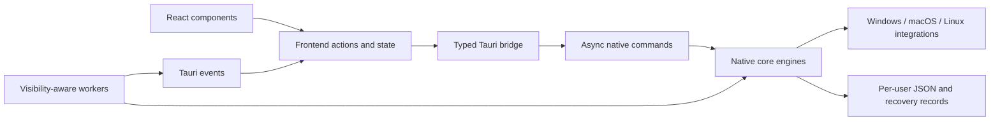

# NetMask architecture

The app has one runtime: Tauri 2 hosts a system webview and a Rust backend. React, TypeScript, Zustand, and Vite build the interface. Network, storage, background, and update operations are native Rust engines.

## Desktop host and native core

`src-tauri/src/lib.rs` owns the main window, branded tray, single-instance lock, worker stop flag, window-size persistence, and orderly shutdown. Its command handlers live in `commands.rs`. Slow handlers use `tauri::async_runtime::spawn_blocking` so subprocesses, downloads, locks, and diagnostics do not block the window thread.

The workspace's `netmask-core` crate points to `src-tauri/src/core.rs`. It contains the platform adapters, settings, rename/recovery operations, DNS, transfer measurements, ping, portal detection, QR sharing, identity controls, roaming, streamer automation, and updater. Separating it from the webview permits actual native-engine tests without launching a desktop or changing a real network.

## Network identity and changes

A network snapshot returns saved profiles, the connected network, and a separate connection error. Stable identities survive display-name changes: Windows Network List GUIDs, macOS network-service UUIDs, and Linux NetworkManager UUIDs. A saved profile's connection parameters remain distinct from its editable local label.

`operations.rs` serializes name changes with a file lock. It refreshes the network, rejects stale expected names, writes the original before changing the OS, and asks the platform adapter to confirm the resulting label. Restore-all retains failed entries and reports partial failure. Backup imports merge records rather than overwriting an existing original.

Windows uses the Network List Manager and WLAN APIs alongside permission-controlled configuration commands. Ambiguous profiles are marked non-editable. macOS changes a service label with `networksetup`; it does not remove and recreate the Wi-Fi network. Linux changes NetworkManager connection names with `nmcli` and uses UUIDs for reconnects.

These are local labels. The router's broadcast SSID and any operating-system UI that chooses to show it remain governed by the router and OS.

## Persistence

Preferences and recovery records stay in the current account's data directory:

| System | Directory |
| --- | --- |
| Windows | `%LOCALAPPDATA%\NetMask` |
| macOS | `~/Library/Application Support/NetMask` |
| Linux | `$XDG_CONFIG_HOME/netmask`, or `~/.config/netmask` |

An absolute `NETMASK_DATA_DIR` override is available for isolated diagnostics. Tests inject temporary storage explicitly. Launching a diagnostic app also requires preferences that turn off automation; changing its data directory alone does not disable network operations.

`settings.rs` bounds JSON size, validates preferences and imports, merges new defaults into old preferences, serializes mutations with OS file locks, and replaces complete files atomically. On Unix it sets private directory/file permissions. Parse failures preserve the original file and surface an error rather than treating corrupt recovery data as an empty backup.

Windows migration copies missing settings and name files from the previous ProgramData location. It does not delete the old files or overwrite existing per-user data. `names.json` stores original labels and `streamer.json` stores a recoverable masking session. These files are JSON, not encrypted storage.

## Fieldnotes interface and events

`bridge.ts` maps the typed `window.nm` contract to Tauri `invoke`. `types.ts` and `env.d.ts` describe arguments, snapshots, status, and events. Add a command by updating the Rust handler, handler registration, bridge, and types together.

Event subscribers return cleanup functions and handle cleanup arriving before the asynchronous listener has registered. Events include speed, ping, captive-portal state, streamer status, update progress, visibility, and maximization.

`network-actions.ts` coalesces overlapping refreshes and forces a fresh snapshot after a mutation. Network filtering and keyboard selection use the same helpers. `settings-queue.ts` serializes optimistic writes and rolls a failed write back to confirmed settings without overwriting a newer choice. `update-actions.ts` owns update actions and synchronizes native download status.

Fieldnotes tokens define paper, green, and terracotta colors, serif display names, readable body type, and both themes. Shared `Controls` provide custom Select, Toggle, HelpTip, Tooltip, and Popover components. Popovers render outside scroll containers, stay within the viewport, and consume Escape before a parent dialog. Select keeps keyboard focus on its trigger, supports typeahead, and scrolls the active option into view.

The shared `Dialog` portals into the document body, makes the underlying app inert and hidden from assistive technology, traps focus, handles Escape, and restores focus when closed. Nested dialogs apply the same protection to the underlying dialog. The app and every dialog use a bounded scroll area so controls remain reachable at the 320 × 200 minimum window size.

## Background work and measurement

Transfer samples run once per second while the window is visible. Counter resets, missing samples, and interface changes reset the baseline. Windows reads adapter counters through native APIs; Linux reads `/proc/net/dev`; macOS reads interface counters from `netstat`. Measured transfer rate is distinct from negotiated link rate and the explicit download speed test.

Visible ping telemetry runs every two seconds. Captive-portal checks run about every 30 seconds while visible and emit state changes. Streamer status ticks once per second, with process scans every five seconds, including in the tray. Cooldown uses elapsed time. Manual masking persists independently of broadcast-process detection. Failed automatic operations do not open administrator prompts or claim protection succeeded.

The window hides to the tray rather than being destroyed. There is no claimed fixed Tauri RAM footprint or GPU-disable mode. See [BENCHMARKS.md](../BENCHMARKS.md) for measurement limits.

## External processes and updates

`system.rs` executes direct argument lists, hides Windows subprocess windows, enforces deadlines including inherited output pipes, stops process groups/job trees on timeout, and avoids echoing private subprocess output in errors. Permission-controlled operations propagate child failures.

The updater accepts the repository's stable GitHub releases, chooses the exact platform-specific native asset, limits redirect hosts and file size, verifies GitHub's SHA-256 digest, and retains native progress/status. Installation opens only the tracked verified path and rechecks its size and hash. Missing digests or unsupported architectures direct the user to the release page.

The production CSP restricts scripts, images, connections, objects, and framing. Capabilities apply to the main window. Website opening accepts HTTP/HTTPS addresses and passes them directly to the OS opener.

## Branding, build, and release

[The selected Orbit SVG](branding/logos/orbit/mark.svg) is the branding source. `scripts/apply-branding.cjs` promotes its desktop exports and generates the renderer mark. `scripts/generate-installer-assets.py` creates the committed NSIS/MSI and DMG artwork. Builds do not require the image-generation tools.

`npm run test:ui` checks the built renderer and HTML studies in a browser with fictional IPC responses. It covers dropdown interaction, nested focus/scrolling, errors, names, sharing, and the minimum window size without operating-system mutations.

`npm run build` produces `dist` from Vite. Tauri compiles the Rust host and installers; the release matrix builds Windows x64, Apple silicon, Intel macOS, and Linux x64. It stages only the expected native package names, requires all six before publishing, and creates a SHA-256 manifest. No second desktop framework is installed or shipped.

See [the audit](AUDIT.md) for fixes and verification boundaries and [the release guide](../RELEASE_GUIDE.md) for the required checks and publication sequence.
