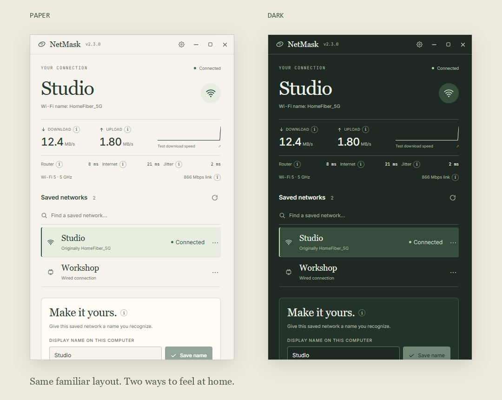

# NetMask

### Know your connection. Control what you show.

NetMask is a local-first desktop companion for understanding how a connection behaved, preparing for calls, managing what appears on screen, and keeping local network labels familiar and recoverable.



<sub>Fieldnotes: warm paper, green ink, and room to breathe. All shown networks and measurements are fictional.</sub>

## Follow a connection over time

1. **Enable local monitoring.** Choose 7, 30, or 90 days of retention. Pause whenever you want.
2. **Open History.** Review measured drops, latency spikes, jitter, and network switches. Missing samples remain missing.
3. **Check Usage and This week.** See observed data use per saved network and an evidence-aware weekly digest. Personal limits warn near and over the amount you set.
4. **Export a provider report.** Choose a period, preview the evidence, and save readable HTML or Markdown. Identifiers are redacted by default and Wi-Fi passwords are never included.

Observed usage is what this computer counted, not a billing-grade provider total. Digests say plainly when there is not enough measured history to support a finding.

## Prepare without surprises

**Going live** checks the router, an internet target, and sign-in state before turning on sharing mode. Supported call or broadcast app detection can offer to do this, but every prompt and action is opt-in.

Per-network presets can hold a preferred local label and display choices. NetMask previews every change, asks when the operating system requires permission, and provides a safe undo. Calm alerts require confirmation and enough baseline history before reporting a changed access point or sharp behavior shift.

Sharing mode changes what NetMask displays. It does not anonymize the connection or hide details in other applications. New access points can be normal mesh or enterprise roaming, so alerts describe a change rather than claiming an attack.

## Download v2.7.0

- **Windows 10 / 11 · x64** — [Setup](https://github.com/billighost/netmask/releases/download/v2.7.0/NetMask_2.7.0_x64-setup.exe) · [MSI](https://github.com/billighost/netmask/releases/download/v2.7.0/NetMask_2.7.0_x64_en-US.msi)
- **macOS 12+ · Apple silicon** — [DMG](https://github.com/billighost/netmask/releases/download/v2.7.0/NetMask_2.7.0_aarch64.dmg)
- **macOS 12+ · Intel** — [DMG](https://github.com/billighost/netmask/releases/download/v2.7.0/NetMask_2.7.0_x64.dmg)
- **Linux · x64 · NetworkManager** — [DEB](https://github.com/billighost/netmask/releases/download/v2.7.0/NetMask_2.7.0_amd64.deb) · [AppImage](https://github.com/billighost/netmask/releases/download/v2.7.0/NetMask_2.7.0_amd64.AppImage)

[Release notes](https://github.com/billighost/netmask/releases/tag/v2.7.0) · [Checksums](https://github.com/billighost/netmask/releases/download/v2.7.0/checksums.txt) · [Privacy and installation notes](../../SECURITY.md)

## Made for a small corner of the desktop

The app stays usable at **320 × 200**, supports Paper and Dark themes, and keeps unsupported platform controls disabled with a plain explanation. Monitoring data, settings, presets, labels, and recovery records stay local. Monitoring data can be deleted without removing saved labels or their recovery records.

<details>
<summary>Build NetMask or contribute</summary>

Install Node.js 22.12+, Rust 1.90+, and the [Tauri prerequisites](https://v2.tauri.app/start/prerequisites/).

```sh
npm ci
npm run dev
```

Read [Contributing](../../CONTRIBUTING.md), [Architecture](../ARCHITECTURE.md), [the audit](../AUDIT.md), or [the release guide](../../RELEASE_GUIDE.md).

</details>

Made by **Bello Bilal** · [@billighost](https://github.com/billighost) · `bb2010ng@gmail.com` · [MIT license](../../LICENSE)
