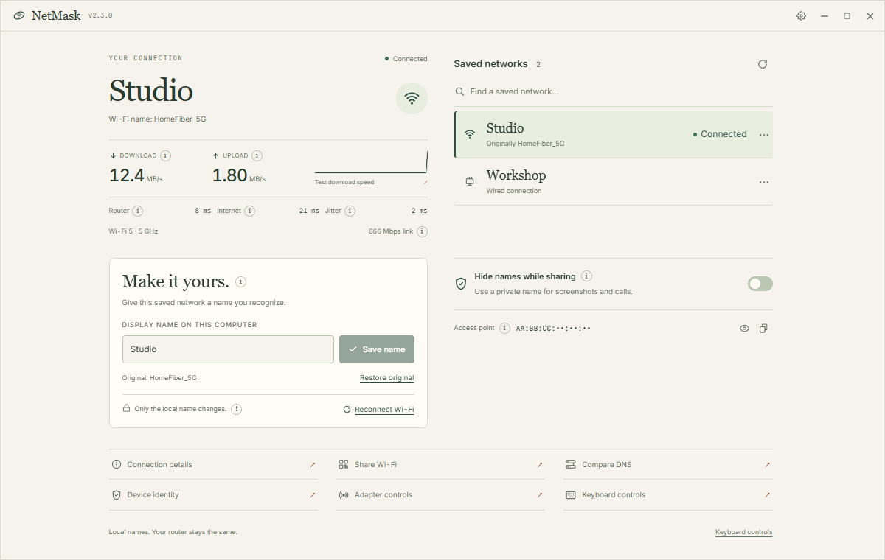

<p><picture><source media="(prefers-color-scheme: dark)" srcset="../../src/renderer/public/branding/mark-light.svg"></picture></p>

# NetMask

**Know your connection. Control what you show.**

Local connection history, observed data use, Going live checks, reversible network presets, evidence-aware weekly findings, provider reports, calm alerts, and recoverable local labels for Windows, macOS, and Linux.

## Download v2.7.0

| Your computer | Get the app | Install |
| --- | --- | --- |
| **Windows 10 / 11 · x64** | [Setup](https://github.com/billighost/netmask/releases/download/v2.7.0/NetMask_2.7.0_x64-setup.exe) · [MSI](https://github.com/billighost/netmask/releases/download/v2.7.0/NetMask_2.7.0_x64_en-US.msi) | Run the installer. |
| **macOS 12+ · Apple silicon** | [DMG](https://github.com/billighost/netmask/releases/download/v2.7.0/NetMask_2.7.0_aarch64.dmg) | Drag NetMask into Applications. |
| **macOS 12+ · Intel** | [DMG](https://github.com/billighost/netmask/releases/download/v2.7.0/NetMask_2.7.0_x64.dmg) | Drag NetMask into Applications. |
| **Linux · x64 · NetworkManager** | [DEB](https://github.com/billighost/netmask/releases/download/v2.7.0/NetMask_2.7.0_amd64.deb) · [AppImage](https://github.com/billighost/netmask/releases/download/v2.7.0/NetMask_2.7.0_amd64.AppImage) | Install the DEB or make the AppImage executable. |

[Release notes](https://github.com/billighost/netmask/releases/tag/v2.7.0) · [Checksums](https://github.com/billighost/netmask/releases/download/v2.7.0/checksums.txt) · [Installation and privacy notes](../../SECURITY.md)

## Inside the app

<picture><source media="(prefers-color-scheme: dark)" srcset="../assets/fieldnotes-dark.png"></picture>

<sub>The Fieldnotes interface with fictional networks and sample measurements.</sub>

## Start with these

1. **Enable monitoring deliberately.** History and usage stay off until enabled. Choose retention, pause sampling, or delete all monitoring records.
2. **Answer “what happened yesterday?”** Open History for measured drops, latency spikes, jitter, switches, and visible gaps. Open This week for findings that admit when evidence is thin.
3. **Set a network limit.** Usage totals stay tied to saved networks across restarts and adapter changes, but are labelled as observed on this computer rather than provider billing data.
4. **Choose Going live before a call.** NetMask checks the connection, enables sharing mode, and reports readiness in plain language. Supported app detection only offers a prompt.
5. **Build a provider report.** Preview measured evidence with identifiers redacted by default; missing samples remain missing and Wi-Fi passwords are never included.

Per-network presets preview label and display changes before applying them and support undo. Alerts are opt-in, require confirmation, use cooldowns, and describe access-point or behavior changes without assuming a security incident.

## Honest boundaries

- All monitoring and configuration data stays on this device; NetMask adds no telemetry service.
- Sharing mode affects NetMask’s display, not other applications, the router, or internet anonymity.
- Local label support and available readings vary by OS, adapter, driver, and permission. Unsupported controls explain why.
- The interface remains usable at **320 × 200** in Paper and Dark themes.

## Development

Tauri 2 + Rust + React + TypeScript. Install Node.js 22.12+, Rust 1.90+, and the [Tauri prerequisites](https://v2.tauri.app/start/prerequisites/).

```sh
npm ci
npm run dev
```

[Contributing](../../CONTRIBUTING.md) · [Architecture](../ARCHITECTURE.md) · [Audit](../AUDIT.md) · [Release guide](../../RELEASE_GUIDE.md)

Created and maintained by **Bello Bilal** · [@billighost](https://github.com/billighost) · `bb2010ng@gmail.com` · [MIT](../../LICENSE)
