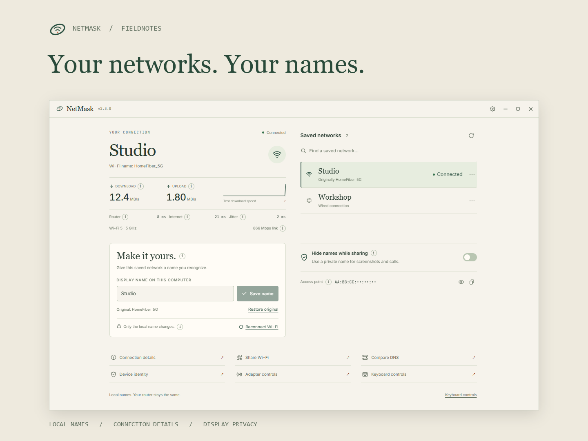

<picture><source media="(prefers-color-scheme: dark)" srcset="../assets/fieldnotes-cover-dark.png"></picture>

# NetMask

A small desktop app for giving saved networks names you recognise. Original names stay recoverable, connection details stay close, and your screen stays easy to read.

**`HomeFiber_5G` → `Studio`.** Choose a network, write a name, and select **Save name**. Choose **Restore original** whenever you want it back.

## Keep it simple

| Make it familiar | See what's happening |
| --- | --- |
| Rename a local label and keep its original. Apply a private display name when sharing your screen. | Read transfer activity, response times, and available Wi-Fi details. Tap a small **i** to understand a value. |
| **Keep tools nearby** | **Use the space you have** |
| Reconnect Wi-Fi, compare DNS, test a small download, or share supported Wi-Fi with a QR image. | Paper and Dark, custom controls, and scrolling panels and dialogs — down to **320 × 200**. |

Only the local label changes; your router keeps broadcasting its Wi-Fi name. Display privacy does not make the connection anonymous. QR codes include readable credentials.

## Take it with you

**v2.3.0** · [What's new](https://github.com/billighost/netmask/releases/tag/v2.3.0)

**Windows 10 / 11 · x64**<br>
[Download installer](https://github.com/billighost/netmask/releases/download/v2.3.0/NetMask_2.3.0_x64-setup.exe) · [MSI package](https://github.com/billighost/netmask/releases/download/v2.3.0/NetMask_2.3.0_x64_en-US.msi)

**macOS 12+**<br>
[Apple silicon DMG](https://github.com/billighost/netmask/releases/download/v2.3.0/NetMask_2.3.0_aarch64.dmg) · [Intel DMG](https://github.com/billighost/netmask/releases/download/v2.3.0/NetMask_2.3.0_x64.dmg)

**Linux · x64 · NetworkManager**<br>
[Debian / Ubuntu](https://github.com/billighost/netmask/releases/download/v2.3.0/NetMask_2.3.0_amd64.deb) · [AppImage](https://github.com/billighost/netmask/releases/download/v2.3.0/NetMask_2.3.0_amd64.AppImage)

Run the Windows installer. On Mac, drag NetMask into Applications. On Linux, install the DEB or make the AppImage executable and open it.

[Checksums](https://github.com/billighost/netmask/releases/download/v2.3.0/checksums.txt) · [Installation notes](../../SECURITY.md) · [All releases](https://github.com/billighost/netmask/releases)

<details>
<summary>A few platform details</summary>

Windows edits Network List labels, macOS edits service labels, and Linux edits NetworkManager connection names. Tools depend on the OS, adapter, and system permissions; unavailable controls explain their limits. Windows may continue showing the router's original SSID in its Wi-Fi menu. Original labels and preferences stay in your account's data directory.

</details>

<details>
<summary>Build it, understand it, or contribute</summary>

Tauri 2, Rust, React, and TypeScript. Install Node.js 22.12+, Rust 1.90+, and the [Tauri prerequisites](https://v2.tauri.app/start/prerequisites/), then:

```sh
npm ci
npm run dev
```

[Contributing](../../CONTRIBUTING.md) · [Architecture](../ARCHITECTURE.md) · [Audit](../AUDIT.md) · [Release guide](../../RELEASE_GUIDE.md)

</details>

By **Bello Bilal** · [@billighost](https://github.com/billighost) · `bb2010ng@gmail.com` · [MIT license](../../LICENSE)
